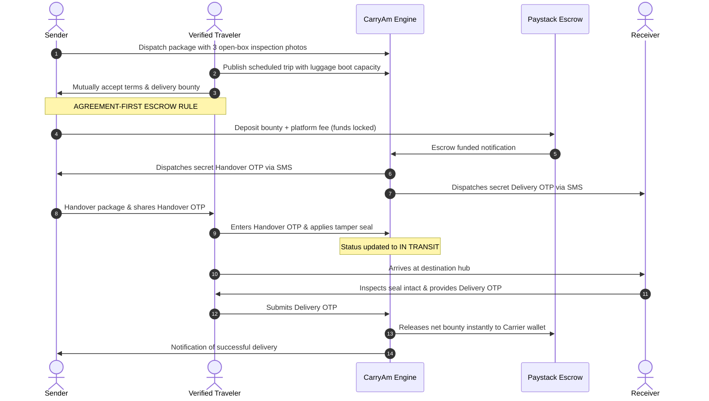

# CarryAm — Peer-to-Peer Intercity Logistics Infrastructure

> **"Carry am give my brother"** — Nigerian peer-to-peer delivery platform connecting verified intercity travelers with senders along scheduled travel corridors.

[](https://nextjs.org/)
[](https://expo.dev/)
[](https://supabase.com/)
[](https://paystack.com/)
[]()

---

## 🌟 The Vision

Traditional intercity parcel delivery in Nigeria suffers from two extremes:
1. **Expensive legacy couriers** (₦7,500 – ₦15,000 for standard intercity items with 2–3 day transit times).
2. **High-risk informal motor park waybills** (zero insurance, high pilferage, untracked drivers, opaque cash transactions).

**CarryAm** formalizes the informal peer-to-peer delivery economy into an insured, biometrically verified, and geofenced digital infrastructure starting on Nigeria's highest-density commercial corridor: **Lagos ⇄ Ibadan (130 KM / ~2h 15m transit)**.

---

## 🛡️ Zero-Trust Security Protocols



1. **Agreement-First Escrow**: Senders are **never** charged upfront. Payment is triggered **only** after both sender and traveler mutually confirm terms, pickup points, and bounty amounts.
2. **Cryptographic Dual-OTP Handshake**:
   - **Handover OTP (4-digit)**: Dispatched to Sender; given to traveler upon physical pickup and tamper-seal application at departure hub.
   - **Delivery OTP (4-digit)**: Dispatched to Receiver; given to traveler only after recipient inspects intact seal at arrival hub.
   - All OTPs are SHA-256 hashed server-side with constant-time byte comparisons (`crypto.timingSafeEqual`) to eliminate timing attacks.
3. **Inspect & Seal Protocol**:
   - Senders must provide at least 3 open-box inspection photos prior to listing.
   - Pre-sealed packages are strictly prohibited. Travelers inspect contents before applying CarryAm tamper-evident numbered seals.
4. **4-Tier Biometric KYC**:
   - Tier 0: SMS Phone Verification
   - Tier 1: NIN Verification via Prembly
   - Tier 2: BVN + Facial Biometrics Match (Gold Tier)
   - Tier 3: Physical Hub Verification & Security Clearance

---

## 🎨 Brand Identity

- **Sky Blue (`#0284C7` / `#0EA5E9`)**: Primary brand color representing trust, safety, and swift transit.
- **Pure White (`#FFFFFF`)**: Background and clean card containers.
- **Gold Lining (`#D4AF37` / `#F59E0B`)**: Borders, status badges, and accent glow representing verified escrow security and premium trust.

---

## 📁 Repository Structure

```text
carryam/
├── apps/
│   ├── web/                    # Next.js 15 Web Application
│   │   ├── src/app/
│   │   │   ├── page.tsx        # Corridor landing page & live rate calculator
│   │   │   ├── send/           # Package consignment dispatch wizard
│   │   │   ├── travel/         # Traveler trip scheduler & earnings planner
│   │   │   ├── trips/          # Corridor trips marketplace
│   │   │   ├── packages/       # Carrier consignment board
│   │   │   ├── agreements/[id]/# Agreement contract room & Paystack escrow deposit
│   │   │   ├── tracking/[id]/  # Live waybill tracking & dual-OTP handshake console
│   │   │   ├── dashboard/      # Carrier wallet, NIP withdrawal, transaction ledger
│   │   │   └── api/            # 9 Production REST API route handlers
│   │   │       ├── trips/      # List & create travel trips
│   │   │       ├── packages/   # List & create package consignments
│   │   │       ├── agreements/ # Agreement contract management
│   │   │       ├── escrow/     # Paystack transaction verification & escrow funding
│   │   │       ├── handover/   # Constant-time dual-OTP verification
│   │   │       ├── wallet/     # Ledger summary & atomic bank transfers
│   │   │       └── webhooks/   # Paystack HMAC-SHA512 webhook handler
│   │   ├── src/lib/            # DB layer, Zod schemas, rate limiters, auth context
│   │   └── test/               # Node test runner unit tests (crypto, validation, rate limits)
│   └── mobile/                 # React Native Expo Mobile App (iOS / Android)
│       ├── app/                # Expo Router native screens
│       └── app.json            # Expo configuration (co.carryam.app)
├── packages/
│   └── shared/                 # Shared domain types, PostGIS RPCs, pricing math
│       ├── src/types.ts        # Pure TypeScript domain models
│       ├── src/theme.ts        # Brand color design tokens
│       └── test/               # Delivery pricing engine tests
└── supabase/
    ├── migrations/             # 12 PostgreSQL 16 + PostGIS production tables
    └── seed.sql                # Beachhead corridor test seed data
```

---

## 🚀 Getting Started

### Prerequisites
- Node.js `v20+` (tested on Node `v24.21.0`)
- npm `v10+`

### 1. Clone & Install
```bash
git clone https://github.com/Cyber-Sage-Black/CarryAm.git
cd CarryAm
npm install
```

### 2. Configure Environment Variables
Copy `.env.example` in `apps/web/` to `.env.local`:
```bash
cp apps/web/.env.example apps/web/.env.local
```

Fill in:
```env
NEXT_PUBLIC_SUPABASE_URL=https://your-project.supabase.co
NEXT_PUBLIC_SUPABASE_ANON_KEY=your-anon-key
SUPABASE_SERVICE_ROLE_KEY=your-service-role-key
PAYSTACK_SECRET_KEY=sk_test_xxxxxxxxxxxxxxxxxxxx
NEXT_PUBLIC_PAYSTACK_PUBLIC_KEY=pk_test_xxxxxxxxxxxxxxxxxxxx
PAYSTACK_WEBHOOK_SECRET=whsec_xxxxxxxxxxxxxxxxxxxx
TERMII_API_KEY=your-termii-api-key
TERMII_SENDER_ID=CarryAm
```

### 3. Run Automated Tests
```bash
npm test
```
Executes all 14 unit test suites across cryptographic verification, rate limiting, Zod validation, and pricing engine logic.

### 4. Build & Start Web Application
```bash
# Build production bundle (19 routes)
npm run build:web

# Run local development server
npm run dev:web
```
Open [http://localhost:3000](http://localhost:3000) to view the platform.

---

## 🔒 Security Architecture Highlights

- **Anti-Clickjacking**: `X-Frame-Options: DENY` on all routes.
- **Strict Content Security Policy (CSP)**: Whitelisted to Paystack iframe, Supabase connections, and trusted CDNs.
- **Timing-Safe Crypto**: Uses `crypto.timingSafeEqual` over fixed-length binary buffers to defeat side-channel analysis on webhook digests and OTP hashes.
- **Atomic Double-Entry Ledger**: Ledger debits are reserved prior to external transfer dispatch, eliminating race conditions and double-spending vulnerabilities.
- **In-Memory Rate Limiting**: Multi-tier LRU cache sliding windows restricting brute-force attacks on OTP endpoints.

---

## 📄 License
UNLICENSED — All Rights Reserved © 2026 CarryAm Technologies Nigeria Ltd.
